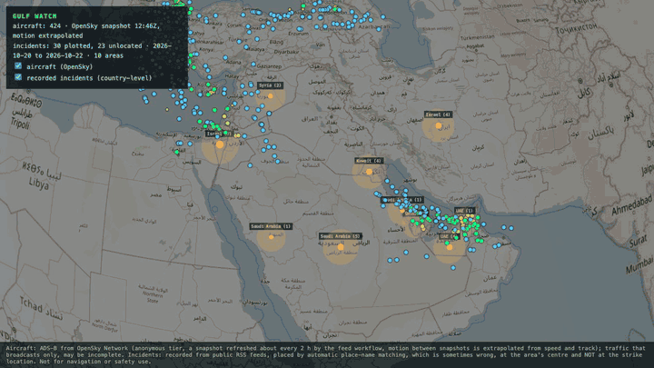

# Gulf Watch

**Aircraft over the region and recorded security incidents, Turkey to Oman, on one map. No account, no API key.**



Live: https://gulfwatch.live (regional view: https://gulfwatch.live/globe.html)

## Quick start

```bash
git clone https://github.com/nKOxxx/gulf-watch-v2
cd gulf-watch-v2
python3 -m http.server 4173 -d public     # any static server works, nothing to install
# open http://localhost:4173/globe.html
```

To refresh the data yourself: `python3 scripts/fetch_flights.py` (aircraft, keyless) and `python3 scripts/fetch_rss_fixed.py` (incidents).

## What you are looking at

| Layer | Source | Precision |
|---|---|---|
| Aircraft | ADS-B from the [OpenSky Network](https://opensky-network.org) anonymous API, saved to `public/flights.json` by `scripts/fetch_flights.py` | Exact at snapshot time (about every 2 h). Motion in between is extrapolated from speed and track. Incomplete where there are no receivers |
| Incidents | Public RSS feeds and official government accounts, from `scripts/fetch_rss_fixed.py` | **Country or region level.** Markers sit at the reported area's centre, not the strike location. Place matching is automatic and sometimes wrong (see Known issues). Incidents with no recognised place are listed as "unlocated" and not plotted |
| Basemap | [OpenStreetMap](https://www.openstreetmap.org/copyright) tiles in [CesiumJS](https://cesium.com/platform/cesiumjs/) (Apache-2.0) | n/a |

Not for navigation, emergency response, or any safety-critical use.

## Known issues

- The incident geocoder (`scripts/coordinate_extractor.py`) mislabels some stories. Example from 2026-10-22: a story about US and Israeli plans for strikes on Iran is pinned at Iran's centre but labelled Israel, and a Syria raid story is pinned in Saudi Arabia. 23 of 53 incidents had no place at all.
- OpenSky shows few aircraft over Iran, Iraq, Syria and the Saudi interior. That is receiver coverage, not proof of empty airspace.

## Sources

News and official feeds are listed in `scripts/fetch_rss_fixed.py`. Prices: see `scripts/fetch_prices.py`. Aircraft: OpenSky Network. The feed workflow (`.github/workflows/update-feeds.yml`) runs every 2 hours; `NEWSDATA_API_KEY`, `OPENSKY_USER` and `OPENSKY_PASS` are optional secrets for that job only.

## More

The previous README, unedited, is in [`docs/FEATURES_FULL.md`](docs/FEATURES_FULL.md). Counts and claims in it are historical.
